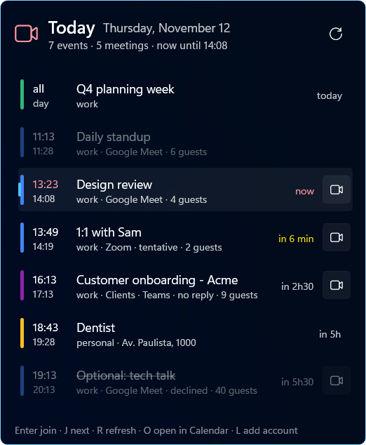
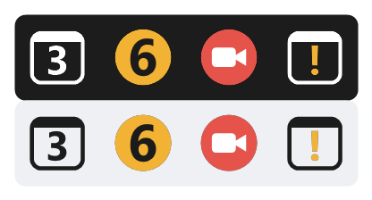
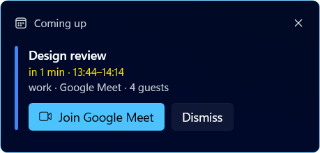

# Google Agenda Tray

Today's agenda from **several Google accounts** in the Windows tray, with one click to
join the meeting.

A Windows port of the [omarchy-agenda](https://github.com/esasse/omarchy-agenda) plugin:
the tray icon says what is going on (a meeting in progress, one starting in a few
minutes, or how many events are left today), and the popup lists the whole day, merged
across every account and calendar, with a button per row to join the call.

<p align="center">
  
</p>

## How it works

- **Your own OAuth client.** The app reads your calendars through an OAuth client of
  your own Google Cloud project (free), with read-only access to the calendar. Nothing
  goes through a server in between; the app talks straight to the Calendar API.
- **WinUI 3 + C#.** The popup is a Windows 11 flyout (acrylic, rounded corners, light or
  dark with the system). The tray icon is plain `Shell_NotifyIcon`: WinUI has no tray
  icon of its own, and going to Win32 directly costs a hundred lines and no dependency.
- **One process, no helpers.** The original plugin ran a Python helper on every poll;
  here the same logic lives in the app, which polls every three minutes and keeps the
  countdowns alive with a 15-second clock that never touches the network.

The tray icon has four states, drawn to match the taskbar's theme:

<p align="center">
  
</p>

| Icon | Meaning |
|---|---|
| calendar page with a number | how many events are left today (not counting all-day or declined ones) |
| amber disc with a number | the next meeting starts in that many minutes (10 or less) |
| red disc with a camera | a meeting is going on now |
| calendar page with `!` | setup pending, or nothing to show and an error |

The tooltip has the words: `3 events left today` / `Now: Product sync (ends in 12 min)` /
`Next: 14:30 Design review (in 25 min)`. Before the day's first fetch the calendar page
shows `…` instead of a number.

## Requirements

- Windows 10 (19041) or 11, x64 or ARM64
- [.NET 10 SDK](https://dotnet.microsoft.com/download) to build — `winget install Microsoft.DotNet.SDK.10`.
  The Windows App SDK is bundled into the output; nothing else to install.

## Install

```powershell
git clone https://github.com/esasse/google-agenda-tray.git
cd google-agenda-tray
powershell -ExecutionPolicy Bypass -File .\build.ps1
powershell -ExecutionPolicy Bypass -File .\Install-Autostart.ps1
```

`build.ps1` publishes the app into `dist\` (stopping a running copy first, since Windows
locks the files of a running `.exe`). `Install-Autostart.ps1` creates a shortcut in your
Startup folder — no UAC, no scheduled task — starts the app, and pins its icon to the
taskbar instead of the `^` overflow menu, where Windows 11 puts every new tray icon.

To uninstall: `powershell -ExecutionPolicy Bypass -File .\Install-Autostart.ps1 -Remove`

## Setup (once)

1. **Project** — <https://console.cloud.google.com/projectcreate>
   (personal Gmail account: Organization = "No organization")
2. **API** — enable the
   [Google Calendar API](https://console.cloud.google.com/apis/library/calendar-json.googleapis.com)
   on that project
3. **Consent** — <https://console.cloud.google.com/auth/overview>
   - "Get started": app name, support email, Audience = **External**
   - under *Audience*, click **Publish app**. In "Testing" mode Google expires the
     authorization every 7 days; published, it does not expire — the price is the "app
     not verified" screen on the first authorization (*Advanced > Go to …*).
   - alternative: keep it in Testing and list each account under *Test users*
4. **Credential** — *Credentials > Create credentials > OAuth client ID > Desktop app >
   Create > Download JSON*. On an existing client, *Add secret* gives you a new JSON:
   Google no longer lets you download a secret again after creating it.

Then open the popup. It finds the newest `client_secret_*.json` in Downloads (or on the
Desktop) and offers to use it, or lets you pick any file. **Connect account** opens the
browser for the authorization; repeat it for each account with `L` or *Accounts* in the
tray menu.

**Coming from omarchy-agenda?** The same Google Cloud project works. The setup accepts
omarchy-agenda's own `client.json` as well as the Console's JSON, and its `config.json`
reads here unchanged. Copy the files in its `accounts\` folder into
`%LOCALAPPDATA%\google-agenda-tray\accounts\` and the accounts come over already
connected — the plain-text refresh token in each is encrypted on first read.

## Use

**Tray icon**

| Action | Effect |
|---|---|
| left click | open/close the popup |
| middle click | join the meeting in progress (or the next one) |
| right click | menu: month view, join, refresh, which calendars to show, accounts, setup, configuration, log, quit |
| `Ctrl+Win+A` | open/close the popup from anywhere |

**In the popup**

| Key | Effect |
|---|---|
| `↑` `↓` | move |
| `Enter` or click | join the selected meeting |
| `J` | join the current / next meeting |
| `M` | open the month view |
| `R` | refresh |
| `O` | open the selected event in Google Calendar |
| `L` | connect another account |
| `Esc` | close |

The popup opens on the meeting that matters now, not on the first one of the day. A row
with no video link opens the event in Google Calendar instead. Google links carry
`authuser=<account>`, so the meeting opens under the right account even with several
signed in to the browser. For a calendar of another of your accounts shared with the
connected one, that is the calendar's owner — the address actually invited: your
`work@company.com` calendar shared with `me@gmail.com` opens its meetings as
`work@company.com`, which has to be signed in to the browser too. The join button's
tooltip says so (`Join Google Meet as work@company.com`). This only applies to shared
calendars you can edit; a colleague's calendar shared with you to read opens under the
connected account, since its owner is never signed in to your browser. Meet, Zoom, Teams, Webex,
Whereby, Jitsi, Chime and Slack huddle links are recognised, including ones that only
exist inside the description. A link counts only on the provider's own domain or a
subdomain of it (`us02web.zoom.us` yes, `evilzoom.us` no), over https, and for Webex only
in its join formats, not the call-in or setup pages an invite also carries. The call link
Google attaches to the event must be on one of the same hosts, over https: one from any
other provider is skipped, and the button falls back to a link in the description or,
with none, opens the event in Google Calendar, where the link is.

Launching the app again while it runs opens its popup instead of a second copy.

**Month view**

`M` in the popup (or the grid button next to refresh, or *Month view* in the tray menu)
opens the month in a window of its own, like Google Calendar's month: each day with its
events in the calendar's colour — all-day and multi-day events as one continuous bar
across their days (square-ended where they go on into the week before or after), the
rest with their start time — and `+N more` when a day has more than fits. The selected day is
listed in full on the side, with times, account, calendar and place, and how much of it
is booked (overlaps counted once; all-day and day-long events left out). It is an
ordinary window: it stays open while you work elsewhere, Alt+Tab finds it, and closing it
only hides it. In a narrow window (a tiling window manager's column) the side panel
steps aside and the cells drop the times; hovering an event still shows everything.
The week starts on the day your Windows region says.

| Key | Effect |
|---|---|
| `←` `→` `↑` `↓` | previous / next day, week |
| `Page Up` `Page Down` | previous / next month |
| `T` | today |
| `Enter` or double click | open the selected day in Google Calendar |
| click on an event (side panel) | open it in Google Calendar |
| `R` | refresh |
| `Esc` | close |

The month is fetched when the window opens and every three minutes while it is up;
months already seen show at once and refresh behind. Only today is cached on disk.

**Reminders**

Two minutes before each event a card comes up in the corner above the tray, with
**Join Google Meet** (or Zoom, Teams…) — or **Open in Calendar** for an event with no
call. It appears without taking the focus, so it never eats what you are typing, and it
stays until you join, dismiss it, or the event is ten minutes in (or over, if shorter).
Events starting together share one card. All-day and declined events get none, and a
meeting invited on two accounts gets one. Starting the app a few minutes into a meeting
still reminds you of it. `reminder_minutes` changes the lead time; `0` turns it off.

<p align="center">
  
</p>

## Configuration

`%LOCALAPPDATA%\google-agenda-tray\config.json`, created on first run. *Edit
configuration* in the tray menu opens it; *Reload configuration* applies it.

```json
{
  "aliases": { "erick@company.com": "work" },
  "ignore_calendars": ["pt-br.brazilian#holiday@group.v.calendar.google.com"],
  "hide_declined": false,
  "include_all_day": true,
  "refresh_interval_sec": 180,
  "hotkey": "Ctrl+Win+A",
  "reminder_minutes": 2
}
```

`aliases` renames the account on each row's second line. `ignore_calendars` lists the
calendars left out of the agenda; you don't need to edit it by hand: *Calendars* in the
tray menu has each account's calendars with a check mark, and unchecking one writes its
id here and refreshes (the rest of the file is kept, its comments are not). Calendars
hidden in Google Calendar's own sidebar are left out too and don't appear in that menu.
A calendar shared with two of your accounts has one id, so it goes on or off in both.
`hotkey` accepts
`Ctrl`, `Alt`, `Shift`, `Win` and a letter, digit or `F1`–`F24`; an empty string turns
it off. If the combination is taken by another program the app notes it in the log and
runs without it.

`Win+A`, the original plugin's `Super+A`, is Quick Settings on Windows 11, hence
`Ctrl+Win+A`.

## Where things live

`%LOCALAPPDATA%\google-agenda-tray\`

| File | Contents |
|---|---|
| `client.json` | your project's Client ID/secret |
| `accounts\<email>.json` | refresh token per account, encrypted with DPAPI for your Windows user |
| `cache\<date>.json` | last fetched day — what shows up with no network |
| `config.json` | settings |
| `agenda.log` | log (rotates at 256 KB) |

To try something without touching your accounts, set `GOOGLE_AGENDA_TRAY_HOME` to
another folder before starting the app: everything above then lives there instead.

## When something fails

A failed refresh does not throw the day away: the popup keeps the last fetched day, says
*No network — showing the last saved data*, and the tooltip says it is cached. Failures
retry after 20 s, 60 s, 120 s and 300 s before falling back to the normal interval. The
app watches its own clock: a jump of more than three minutes means the machine was
asleep, so it refreshes right away. It also refreshes once in the 90 seconds before a
meeting starts, to pick up a link or room changed at the last minute.

An account whose authorization was revoked or expired shows as an error naming it;
connect it again with `L`.

When some accounts answer and others do not (or an account answers but one of its
calendars fails), the day on screen is missing those events, and the count on the icon
leaves them out. The tooltip then ends in `(1 account failed)`, and the popup names the
account and the reason.

## Implementation notes

1. **`dotnet publish` leaves out the app's `.pri` and `.xbf` files** for an unpackaged
   WinUI app, although the build writes them, and the published `.exe` then dies in
   `InitializeComponent` with *XAML parsing failed*. A target in the `.csproj` copies
   them; do not remove it.
2. **The tray window is a hidden top-level window, not message-only.** Message-only
   windows do not get broadcasts, and `TaskbarCreated` is how the icon comes back after
   Explorer restarts.
3. **The tooltip limit is 127 characters** with `Shell_NotifyIcon` (WinForms'
   `NotifyIcon` throws above 63). With `NOTIFYICON_VERSION_4` the standard tooltip only
   shows with `NIF_SHOWTIP`.
4. **The OAuth redirect uses a raw `TcpListener` on 127.0.0.1**, not `HttpListener`:
   that one goes through http.sys and wants a URL reservation (admin) for anything other
   than `localhost`. The flow uses PKCE.
5. **The tray menu is dark in dark mode** through two undocumented `uxtheme` ordinals
   (`SetPreferredAppMode`, `FlushMenuThemes`), the same ones Explorer and most tray apps
   use. If they ever go away, the menu just turns light.

## License

MIT
